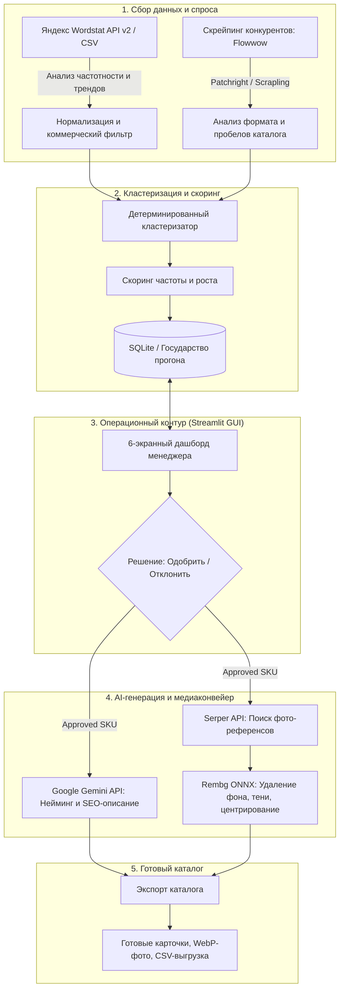

# 🌸 Flower Catalog AI

<p align="center">
  <strong>Интеллектуальный конвейер автоматизации каталога интернет-магазина на основе реального поискового спроса Яндекс Wordstat, семантической кластеризации, LLM-генерации (Gemini) и визуального ИИ (rembg).</strong>
</p>

<p align="center">
  
  
  
  
  
  
  
  
  
</p>

---

## 📌 О проекте

**Flower Catalog AI** — это продуктовый инструмент автоматизации для SEO- и контент-команд, решающий задачу масштабного наполнения каталога товарами с подтвержденным коммерческим спросом.

Вместо ручного сбора семантики, таблиц в Excel и поштучного поиска картинок, система предоставляет сквозной конвейер:
1. **Сбор спроса** через API Яндекс Wordstat v2 с контролем квот и защитой от лимитов (Circuit Breaker).
2. **Семантическая кластеризация** и выделение SKU-атрибутов (цвет, количество стеблей, упаковка, коммерческий интент).
3. **Парсинг конкурентов** (Flowwow и др.) с обходом антифрод-систем через эмуляцию поведения человека (`Patchright` + `Scrapling`).
4. **AI-нейминг и описания** с помощью Google Gemini с гарантией формата через Pydantic-схемы.
5. **Автоматическая подготовка медиаконтента**: поиск референсов и локальное удаление фона нейросетью `rembg` (ONNX Runtime).
6. **Интерактивный GUI на Streamlit** для модерации, утверждения позиций и пакетного экспорта.

---

## 🏗 Архитектура пайплайна



---

## ✨ Ключевые возможности

### 1. Интеграция с Yandex Wordstat (Search API v2)
* **Лавина запросов (Avalanche Queries)**: многопоточный каскадный сбор связанных ассоциаций и дочерних ключей.
* **Бюджетирование квот**: гарантированное резервирование лимита на расчет сезонной динамики (`dynamics`).
* **Паттерн Circuit Breaker**: автоматическое предотвращение блокировок при получении HTTP 429 / Too Many Requests.
* **Гибкий импорт**: поддержка прямого импорта официальных CSV-отчетов Wordstat.

### 2. Детерминированная семантическая кластеризация
* Разбор поисковых фраз на сущности:
  * **Количество** (15, 25, 51, 101 шт).
  * **Цветовая гамма** (розовый, белый, микс и др.).
  * **Формат упаковки** (коробка, корзина, крафт, пленка, монобукет).
* Детерминированный хэш `cluster_id` без коллизий между перезапусками.
* Механизм **Carry-Over решений**: ручные подтверждения менеджера сохраняются даже при обновлении семантического ядра.

### 3. Анти-детект скрейпинг конкурентов
* Стек обхода защиты: `Patchright` (недетектируемый Playwright fork) + `Scrapling` + `curl-cffi`.
* Режим интерактивного обхода (`interactive=True`): эмуляция движения мыши, скролла, ожидания подгрузки AJAX-карточек и обработки Cloudflare Turnstile.
* Сравнение ассортимента конкурентов для выявления упущенных категорий и ходовых форматов.

### 4. Генерация контента на LLM (Google Gemini)
* Генерация продающих заголовков товаров по ГОСТу e-commerce.
* Создание структурированных описаний с эмоциональной подачей и характеристиками.
* Строгая валидация входящих и исходящих данных через схемы `Pydantic v2`.

### 5. AI-фотоконвейер (Computer Vision)
* Поиск релевантных изображений букетов через Google Images / Serper.
* Локальное удаление фона нейросетевыми весами `rembg` (U2Net) на базе `onnxruntime`.
* Добавление реалистичной мягкой тени, автоцентрирование и конвертация в оптимизированный формат WebP.

### 6. Наблюдаемость (Trace Engineering)
* Полный отказ от неструктурированного логирования (`print`).
* Иерархические спаны с разделением на `READ_ONLY` и `MUTATING` операции.
* Фиксация времени исполнения, метаданных и событий без риска утечки секретов и API-ключей.

---

## 🛠 Стек технологий

| Область | Технологии |
| :--- | :--- |
| **Ядро и среда** | Python 3.12+, uv (пакетный менеджер), SQLite |
| **Интерфейс** | Streamlit, Pandas |
| **Искусственный интеллект** | Google Gemini API (`google-genai`), Rembg (`onnxruntime-gpu` / CPU), Pillow |
| **Парсинг и сеть** | Patchright, Scrapling, HTTPX, Requests, curl-cffi |
| **Архитектура данных** | Pydantic v2, Typed Dicts, Structured JSON |
| **Качество кода** | Ruff (linter & formatter), Mypy (строгая типизация), Pytest (unit & integration) |

---

## 🚀 Быстрый старт

### 1. Требования
* Установленный [uv](https://docs.astral.sh/uv/) (рекомендуется) или Python 3.12+
* Git

### 2. Клонирование и установка зависимостей
```bash
# Клонируйте репозиторий
git clone https://github.com/aqwarius2003/flower-catalog-ai.git
cd flower-catalog-ai

# Установите зависимости одной командой
uv sync
```

### 3. Настройка переменных окружения
Создайте файл `.env` на основе шаблона:
```bash
cp .env.example .env
```
Заполните ключи в `.env`:
```ini
# Yandex Cloud (для Wordstat API v2)
YANDEX_CLOUD_API_KEY="ваш_ключ_здесь"
YC_FOLDER_ID="ваш_folder_id_здесь"
WORDSTAT_MAX_REQUESTS=200

# Google Gemini API (для генерации описаний и названий)
GEMINI_API_KEY="ваш_ключ_gemini"

# Serper API (для поиска фото-референсов)
SERPER_API_KEY="ваш_ключ_serper"
```

### 4. Запуск приложения

#### Веб-интерфейс (Streamlit):
```bash
uv run streamlit run app.py
```
Интерфейс откроется в браузере по адресу: `http://localhost:8501`.

#### Консольный интерфейс (CLI):
```bash
# Инициализация базы данных
uv run python main.py init

# Справка по командам CLI
uv run python main.py --help
```

---

## 🧪 Тестирование и качество кода

Проект разработан по инженерным стандартам с обязательным прохождением всех качественных гейтов:

```bash
# Запуск полного набора unit- и integration-тестов
uv run pytest -q

# Проверка линтером Ruff
uv run ruff check .

# Проверка форматирования
uv run ruff format --check .

# Строгая статическая проверка типов Mypy
uv run mypy src
```

---

## 📁 Структура проекта

```text
├── app.py                     # Streamlit GUI (6 экранов операционного пайплайна)
├── main.py                    # Входная точка CLI-модуля
├── pyproject.toml             # Зависимости и конфигурации инструментов (uv, ruff, mypy)
├── .env.example               # Шаблон конфигурации переменных окружения
├── .gitignore                 # Исключение секретов, баз данных и временных файлов
├── docs/                      # Архитектурная документация и журнал решений
│   └── decisions.md           # Architecture Decision Records (ADR)
├── src/                       # Основной исходный код
│   ├── clusterer.py           # Логика семантической кластеризации и скоринга
│   ├── competitors.py         # Модуль анализа конкурентов и форматов
│   ├── db.py                  # Хранилище данных и транзакции SQLite
│   ├── generator.py           # Интеграция с LLM Gemini для текстов карточек
│   ├── image_processor.py     # Обработка фото (rembg, тени, центрирование)
│   ├── image_search.py        # Поиск референсных изображений
│   ├── models.py              # Контракты данных (Pydantic-модели)
│   ├── trace.py               # Движок иерархических спанов (Trace Engineering)
│   ├── wordstat.py            # Клиент Yandex Wordstat API (v2) и парсер CSV
│   └── scraper/               # Движок веб-парсинга
│       ├── core.py            # ScraplerEngine на базе Patchright / Scrapling
│       └── adapters/          # Адаптеры под конкретные маркетплейсы (Flowwow)
└── tests/                     # Автоматические тесты
    ├── fixtures/              # Golden-фикстуры реальных ответов API (Wordstat, JSON)
    ├── test_clustering.py     # Тесты детерминированной кластеризации
    ├── test_competitors.py    # Тесты анализа конкурентов
    ├── test_contracts.py      # Валидация Pydantic-контрактов
    ├── test_db.py             # Тестирование персистентности БД
    ├── test_pipeline.py       # Тесты сквозного пайплайна обработки
    └── test_wordstat.py       # Тесты Wordstat-клиента, квот и Circuit Breaker
```

---

## 📄 Лицензия

Распространяется под лицензией [MIT](LICENSE).
